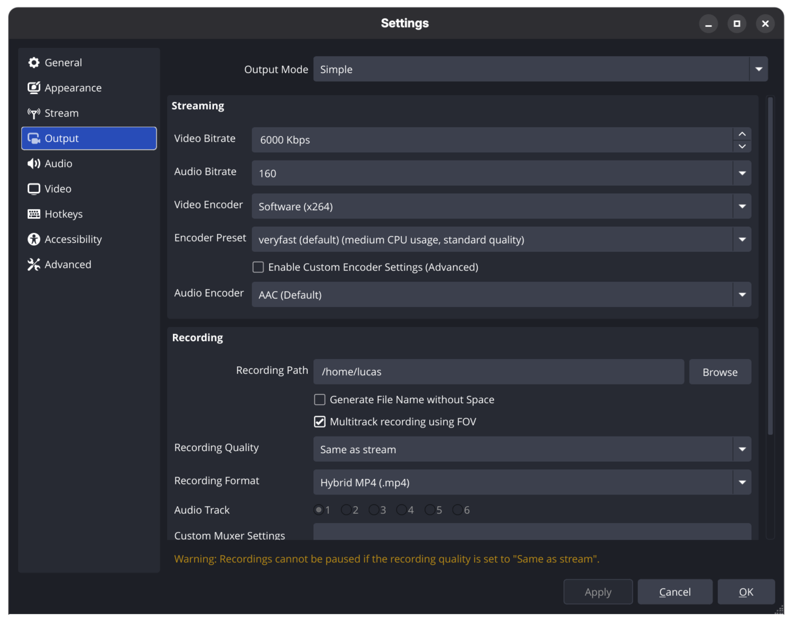
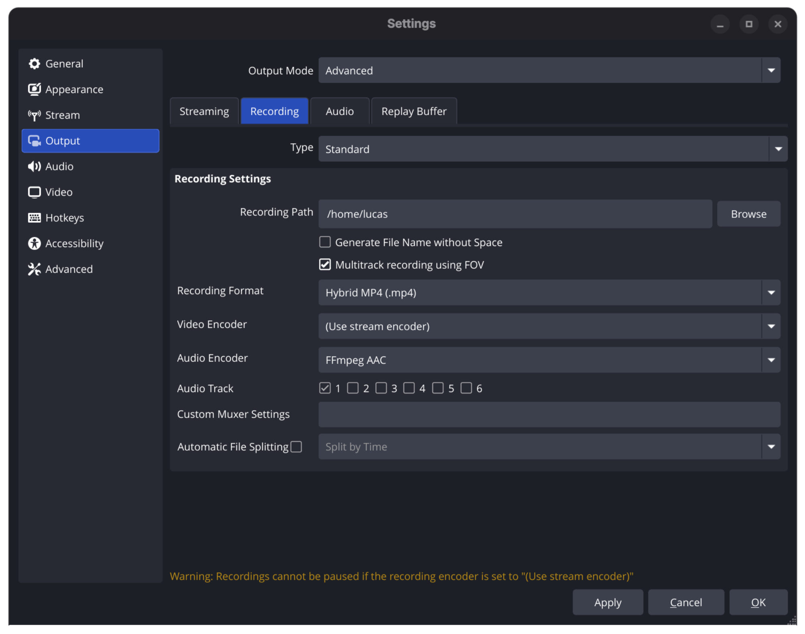
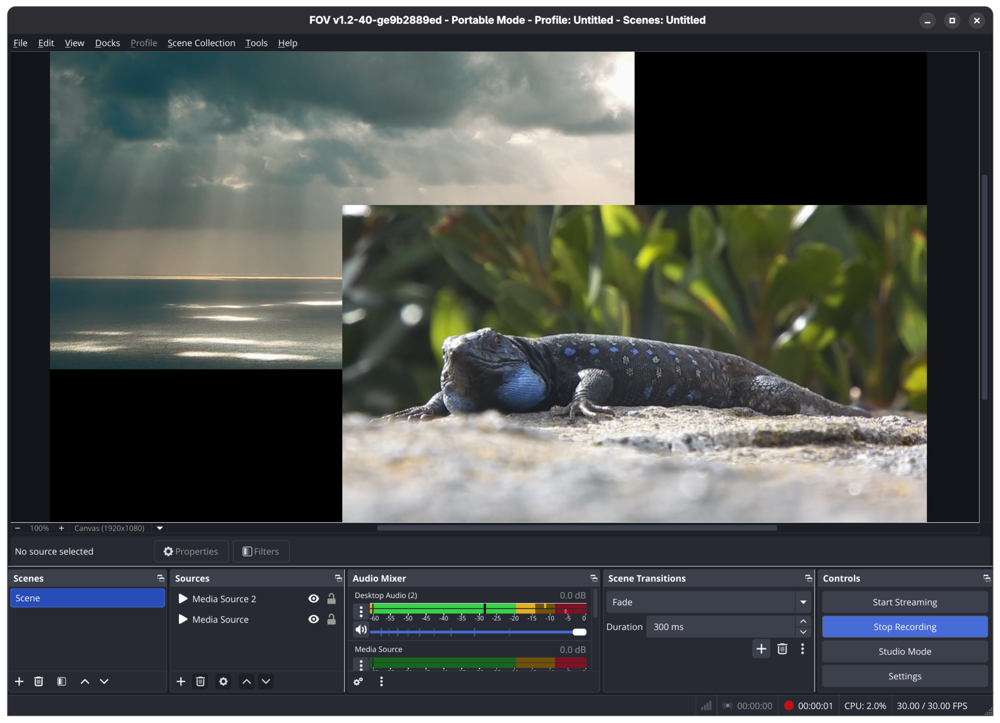
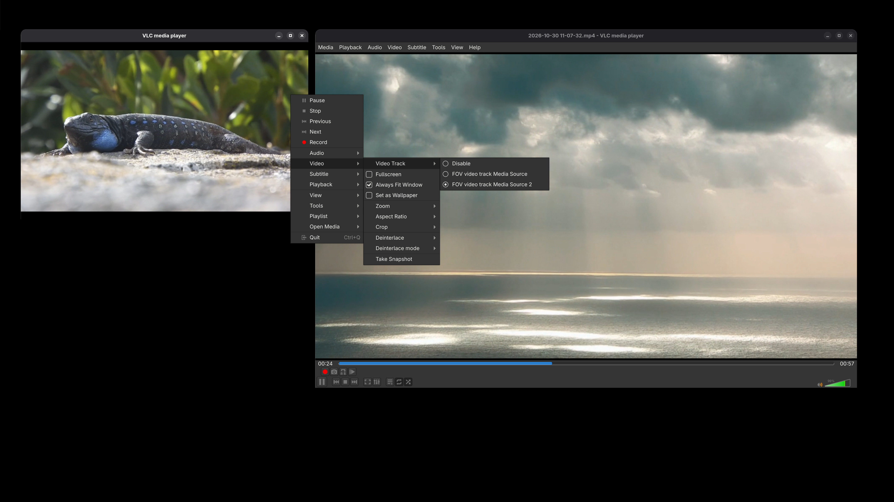
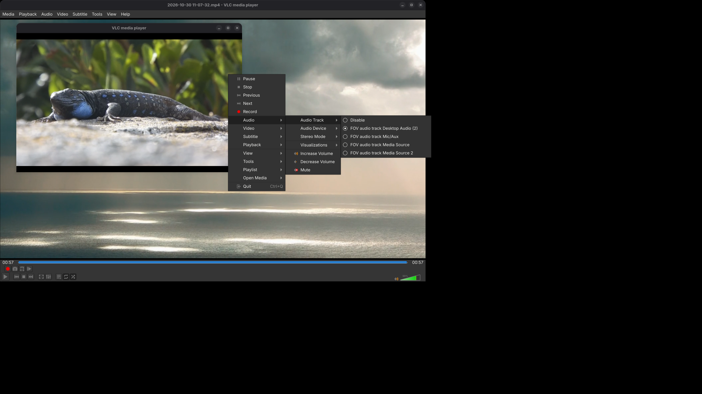

# Local Multitrack Recording

In addition to live broadcasting, FOV Software supports local multitrack video and audio recording.

This feature leverages the same underlying `FOVSystem` architecture as the streaming engine to output isolated source tracks into a single container file.

> [!NOTE]
> For information on configuring live broadcast outputs, refer to the [Start a Stream guide](./start_a_stream.md).

## Technical Prerequisites & File Formats

Multitrack recording relies on container formats capable of multiplexing multiple independent video and audio streams simultaneously.

> [!IMPORTANT] Container Compatibility Requirement
>
> Multitrack local recording is **only supported** when using either the **Hybrid MP4** or **Hybrid MOV** recording format.

## Configuration

You can enable multitrack recording in either **Simple Output Mode** or **Advanced Output Mode**:

1. Open **Settings** and select the **Output** tab in the left sidebar.
2. Navigate to the **Recording** section.
3. Set your **Recording Format** to `Hybrid MP4 (fragmented)` or `Hybrid MOV (fragmented)`.
4. Check the **Multitrack recording using FOV** checkbox.

### Simple Output Mode
In Simple Output Mode, check the FOV multitrack box directly under the recording settings:

### Advanced Output Mode
In Advanced Output Mode, select the **Recording** tab to locate the FOV multitrack checkbox alongside your custom encoder assignments:

## Workflow & Output Behavior

Once enabled, starting a recording captures every active video and audio source present in your current scene as an isolated track inside a single video file.

### Playback & Post-Production

You can review or edit your recorded files using any player or video editor that supports multi-stream containers (e.g., VLC Media Player).

* **Multiple Video Tracks:** You can switch between or view separate video streams.
* **Multiple Audio Tracks:** Each audio channel remains isolated for independent volume balancing or editing in post-production.

