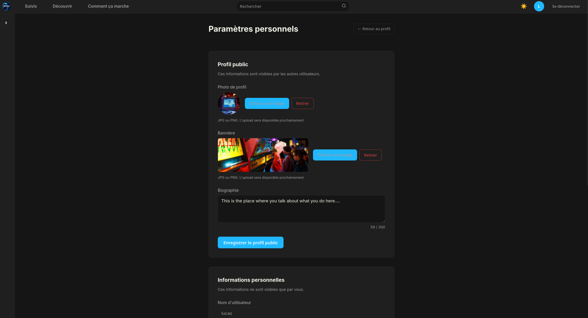
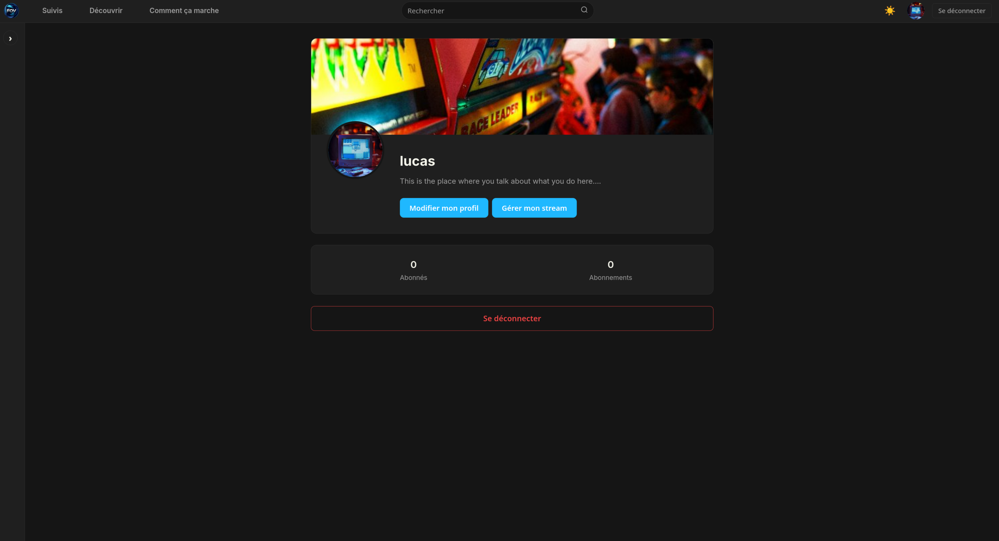
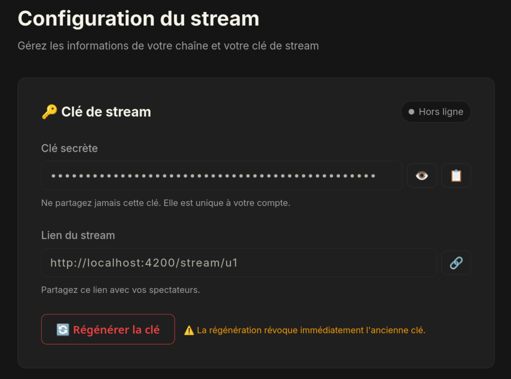
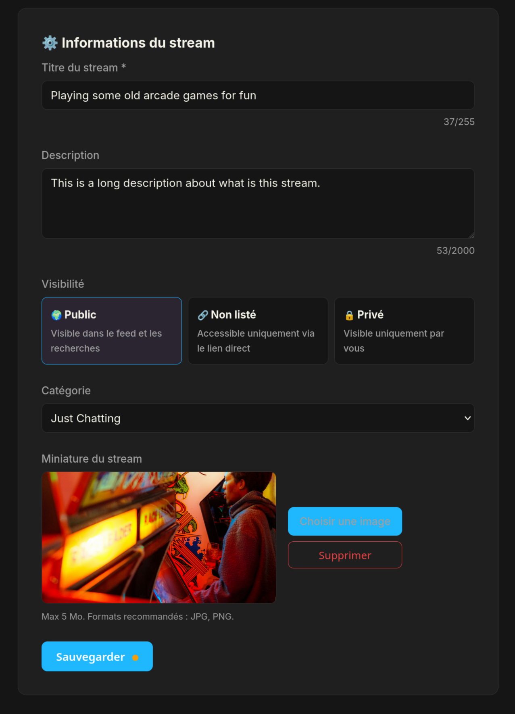

# Prepare FOV

Before you can go live with your multi-track broadcast, you need to set up your account on the web platform, configure your channel details, and retrieve your stream credentials.

> [!NOTE] Public vs. Self-Hosted Instances
>
> The URLs referenced in this guide point to the official public instance (`fovapp.live`). If you are self-hosting the web platform, please replace these URLs with your own server domain and backend address.

---

## Create an Account

1. Head to [https://fovapp.live/register](https://fovapp.live/register) to create your account by providing a public username, email, and password.

2. Once registered, navigate to [https://fovapp.live/profile](https://fovapp.live/profile).
   * From your profile page, you can view your current subscribers and subscriptions, as well as access the profile editing tools.

3. Click **Edit Profile** to customize your channel appearance and security settings:
   * Upload a profile picture and banner.
   * Update your user bio.
   * Change your password.

 
*Profile editing page*

 
*Your channel page*

---

## Configure Your Stream Information

You can access your streaming configuration directly from your profile page or by visiting [https://fovapp.live/dashboard/stream](https://fovapp.live/dashboard/stream). 

### 1. Stream Key & Stream Link Panel

- **Stream Key:** Copy your stream key from this panel. You will need to paste this key directly into the FOV Software stream settings (see [Start a Stream](./start_a_stream.md)).
  > [!IMPORTANT]
  > **Regenerating Your Stream Key:** You can regenerate your stream key at any time, but doing so will instantly invalidate your previous key. If you regenerate it, make sure to update it immediately in your FOV Software configuration.
- **Stream Link:** This shareable link allows viewers to watch your broadcast. It will automatically load and display your stream whenever you go live.

### 2. Stream Information Panel

Customize your broadcast metadata before going live:
- **Title & Description:** Set a clear title and description for your broadcast.
- **Visibility:** Choose your broadcast accessibility:
  - **Public:** Visible to everyone on the platform.
  - **Unlisted:** Hidden from public directories; viewers require the direct link to watch.
  - **Private:** Restricted access.
- **Category:** Select the category that best matches your content.
- **Thumbnail:** Upload a custom preview image for your stream.
