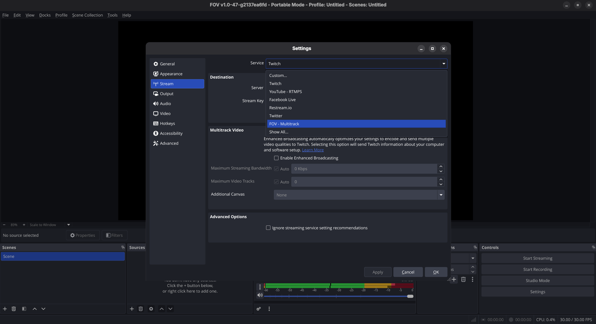
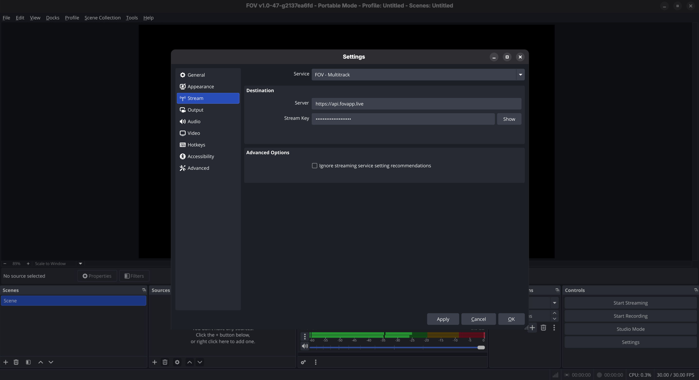
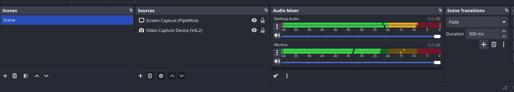
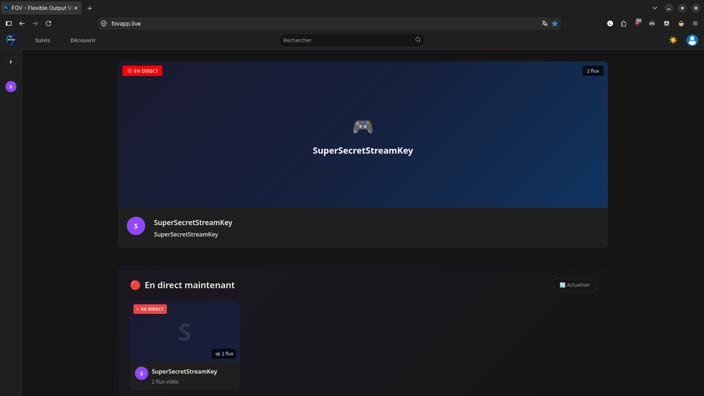
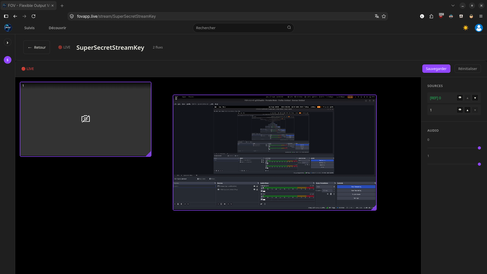

# Start a Stream

Welcome! This guide will walk you through setting up and broadcasting your first interactive multi-track stream using FOV.

## Prerequisites

Before going live, ensure you have the FOV software [installed and running](./installation.md).

---

## Operational Constraints

Because FOV streams sources as independent tracks rather than a single flattened video feed, keep the following operational rules in mind while setting up your workspace:

> [!WARNING] Single-Scene & Layout Lock
>
> FOV operates strictly within a single-scene setup. **Scene switching, as well as adding, removing, or reconfiguring sources, is disabled while streaming.**
>
> Finalize all scene elements before hitting "Start Streaming".

> [!NOTE] Automated Track Isolation & Audio Mapping
>
> * **Automated Tracking:** Track isolation is fully automated by `FOVSystem`. Any source currently visible and active in your active scene automatically spawns its own independent stream track. You do **not** need to manually configure tracks.
>
> * **Fixed Audio Mapping:** Manual track selections in **Advanced Audio Properties** are ignored or overwritten. Audio sources map on a strict 1:1 basis depending on the order they were added.

---

## Quickstart Guide

Follow these steps to configure your broadcast:

### 1. Select the Platform Service
1. Launch FOV Software.
2. Open **Settings** from the main dashboard control interface and select the **Stream** tab in the left sidebar.
3. Set the **Service** dropdown to `FOV - Multitrack`.

### 2. Enter Target Parameters
Populate your connection details:
* **Server URL:** Enter your target platform API endpoint. Use `https://api.fovapp.live` for the public service, or enter your custom backend API URL if self-hosting (see [Developer Documentation](../developer_docs.md)).
* **Stream Key:** Insert your authentication token string.

### 3. Build Your Scene
Add your video and audio sources (game capture, webcam, microphone, desktop audio) to your active scene just as you would in standard OBS.

### 4. Go Live
1. Click **Start Streaming** in the workspace console interface.
2. Open your broadcast URL on [https://fovapp.live](https://fovapp.live) (or your self-hosted web instance).

Viewers can now watch your stream and interact with individual video layers, such as moving and resizing video tracks dynamically on screen.

