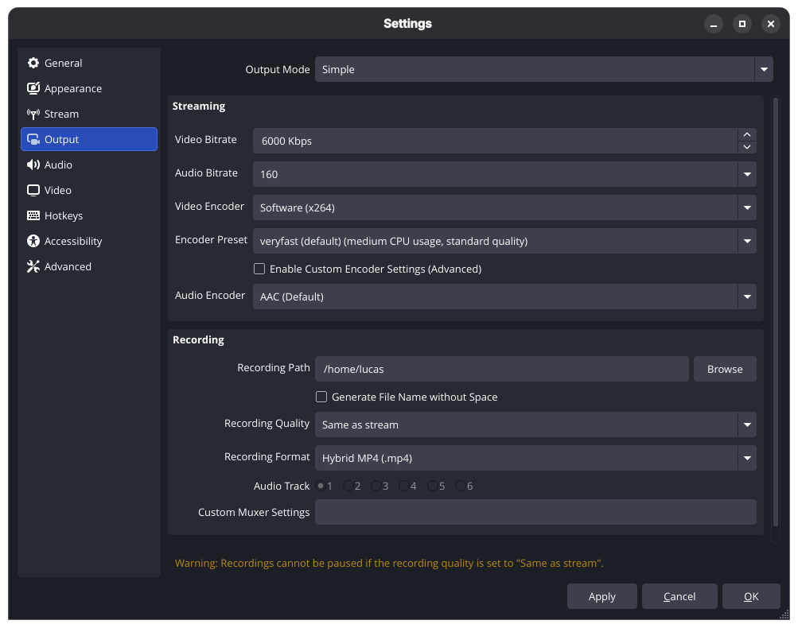

# Stream Settings

Streaming with FOV Software requires a fundamental shift in how you configure and optimize your encoding settings compared to standard OBS Studio.

---

## Architectural Model: Multi-Track Encoding

Unlike traditional streaming software that flattens your entire scene into a single video feed and audio track, FOV processes and broadcasts each source independently:

* **Independent Encoders:** Every active video and audio source in your scene has an encoder attached to it.

* **Per-Track Processing:** Each source is ingested, encoded, and sent as a discrete stream track.

* **Bandwidth & CPU Scaling:** Broadcasting multiple streams simultaneously multiplies your upload bandwidth requirements and processing load based on the cumulative bitrate and count of active tracks.

> [!TIP] Supported Codecs
>
> * **Video:** H.264 (`h264`), H.265 (`h265`)
> * **Audio:** AAC (`aac`), Opus (`opus`)

---

## Simple Output Mode vs. Advanced Output Mode

### Simple Output Mode
In **Simple Output Mode**, FOV applies uniform bitrate and encoding settings across all audio and video tracks.

> [!WARNING] Bandwidth Overhead Warning
>
> Using Simple Output Mode can quickly consume far more network bandwidth than required. For example, if your output bitrate is set to **4000 kbps** for video and **160 kbps** for audio, a scene with 2 video sources and 4 audio sources calculates as:
>
> $$(2 \times 4000\text{ kbps}) + (4 \times 160\text{ kbps}) = \mathbf{8640\text{ kbps total upload required}}$$
>
> Because secondary video sources (like webcams or overlay feeds) rarely require the same high bitrate as a primary gameplay feed, uniform settings can strain your network connection unnecessarily.

---

### Advanced Output Mode (Recommended)

To optimize network performance and system resource usage, we strongly recommend switching to **Advanced Output Mode**. This mode allows you to fine-tune encoding parameters on a per-track basis.

#### 1. Per-Track Video Bitrate & Hardware Encoding
In the Advanced Output settings, you can customize the bitrate and encoder assigned to each video track.

> [!TIP] Hardware Encoding Recommendation
>
> Because every video track requires an active encoding pass, **using dedicated hardware encoders (NVIDIA NVENC, Intel QSV, or AMD AMF) is strongly recommended**.
>
> While software-based encoding (`x264`) can be used, running multiple concurrent CPU streams places a heavy burden on your processor and will lead to a higher CPU usage.

#### 2. Per-Track Audio Bitrate Adjustment
Advanced settings also enable granular control over individual audio track bitrates, allowing you to allocate higher bitrates to primary audio sources (such as music or main microphones) while dialing down secondary commentary or game audio channels.

